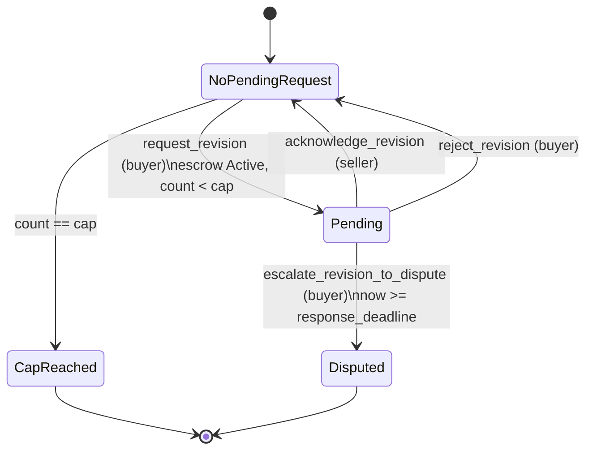

# Escrow Revision Requests

> **Status:** Implemented in `contracts/ahjoor-escrow/src/lib.rs`
> (`request_revision`, `acknowledge_revision`, `reject_revision`,
> `escalate_revision_to_dispute`, `get_revision_request`,
> `get_revision_count`, `set_max_revision_requests`,
> `set_revision_response_deadline`).

---

## Overview

Before releasing funds, the buyer can ask the seller to revise the delivered
work. A revision request records a hash of the buyer's notes and gives the
seller a response deadline. While a request is open, the seller can
acknowledge it, the buyer can withdraw it with `reject_revision`, or, once the
deadline has passed without a response, the buyer can escalate it to a
dispute.

| Fact | Value |
| --- | --- |
| Who can request | The escrow buyer |
| Who can acknowledge | The escrow seller |
| Open requests per escrow | At most one at a time |
| Default revision cap | 3 requests per escrow |
| Default response deadline | 7 days (`7 * 24 * 60 * 60` seconds) |
| Pending request storage | `DataKey3::PendingRevisionRequest(escrow_id)` |
| Counter storage | `DataKey3::RevisionRequestCounter(escrow_id)` |

---

## State Diagram



`NoPendingRequest` and `Pending` describe the revision request. The escrow
itself stays `Active` the whole time, until escalation moves it to
`Disputed`.

---

## The Revision Request

```rust
pub struct RevisionRequest {
    pub request_id: u32,
    pub requested_by: Address,
    pub revision_notes_hash: BytesN<32>,
    pub created_at: u64,
    pub response_deadline: u64,
}
```

`request_id` counts up from `1` for each escrow. `response_deadline` is
`created_at` plus the response deadline that was configured when the request
was made.

---

## Entry Points

### `request_revision`

```rust
pub fn request_revision(env: Env, buyer: Address, escrow_id: u32, revision_notes_hash: BytesN<32>)
```

**Authentication:** `buyer.require_auth()`

**Preconditions:**
1. The contract is not paused.
2. Caller is the escrow buyer (`OnlyBuyerCanRequestRevision`).
3. The escrow is `Active` (`RevisionRequestOnlyAllowedActiveEscrow`).
4. No revision request is already pending (`RequestAlreadyPending`).
5. The escrow is under its revision cap (`MaximumRevisionRequestsReached`).

**Effect:** stores the request, increments the revision counter and emits
`RevisionRequested(escrow_id, request_id, buyer)`.

### `acknowledge_revision`

```rust
pub fn acknowledge_revision(env: Env, seller: Address, escrow_id: u32, request_id: u32)
```

The seller accepts the request and commits to making changes. The caller must
be the escrow seller (`OnlySellerCanAcknowledgeRevision`), a request must be
pending (`NoPendingRevisionRequest`) and `request_id` must match it
(`InvalidRevisionRequestID`). Clears the pending request and emits
`RevisionAcknowledged`.

### `reject_revision`

```rust
pub fn reject_revision(env: Env, buyer: Address, escrow_id: u32, request_id: u32, reason_hash: BytesN<32>)
```

The **buyer** closes their own pending request, for example after settling it
off-chain or deciding to drop it. The caller must be the escrow buyer, and the
request must be pending and match `request_id`. Clears the pending request and
emits `RevisionRejected(escrow_id, request_id, reason_hash)`. The request
still counts toward the cap.

### `escalate_revision_to_dispute`

```rust
pub fn escalate_revision_to_dispute(env: Env, buyer: Address, escrow_id: u32)
```

If the seller has not acknowledged the request by its `response_deadline`,
the buyer can escalate. The caller must be the escrow buyer and a request must
be pending. The call fails with `RevisionResponseDeadlineNotPassed` while
`now < response_deadline`.

**Effect:**
- Clears the pending request.
- Moves the escrow to `Disputed`, updates the active dispute count and records
  the status change in the escrow history.
- Creates a `Dispute` record for the full escrow amount with the reason
  `"Revision request escalation"`.
- Emits `RevisionEscalatedToDispute(escrow_id, request_id)`.

From here the normal dispute flow and dispute timeout rules apply. See
[Dispute Timeout Enforcement](escrow-dispute-timeout.md).

### Views

- `get_revision_request(escrow_id) -> Option<RevisionRequest>`: the pending
  request, if any.
- `get_revision_count(escrow_id) -> u32`: how many requests have been made on
  the escrow.

---

## Revision Cap

```rust
pub fn set_max_revision_requests(env: Env, admin: Address, escrow_id: u32, max_requests: u32)
```

**Authentication:** `admin.require_auth()` and the caller must be the contract
admin.

- The cap is set **per escrow** and defaults to `3` when it is not set.
- `request_revision` is rejected once `get_revision_count(escrow_id) >= cap`.
- The counter only goes up. Acknowledged, rejected and escalated requests all
  stay counted.
- Setting the cap to `0` disables revision requests for that escrow. Lowering
  the cap below the current count blocks further requests but does not affect
  a request that is already pending.

---

## Response Deadline

```rust
pub fn set_revision_response_deadline(env: Env, admin: Address, deadline_seconds: u64)
```

**Authentication:** `admin.require_auth()` and the caller must be the contract
admin.

- Sets the **contract-wide** response window in seconds. The default is 7
  days.
- `deadline_seconds` must be greater than zero (`DeadlineMustBePositive`).
- The window is copied into each request's `response_deadline` when the
  request is created. Changing it later only affects new requests.
- The deadline does not expire a request on its own. The request stays pending
  until the seller acknowledges it, the buyer rejects it, or the buyer
  escalates it. The seller can still acknowledge after the deadline, as long as
  the buyer has not escalated yet.
